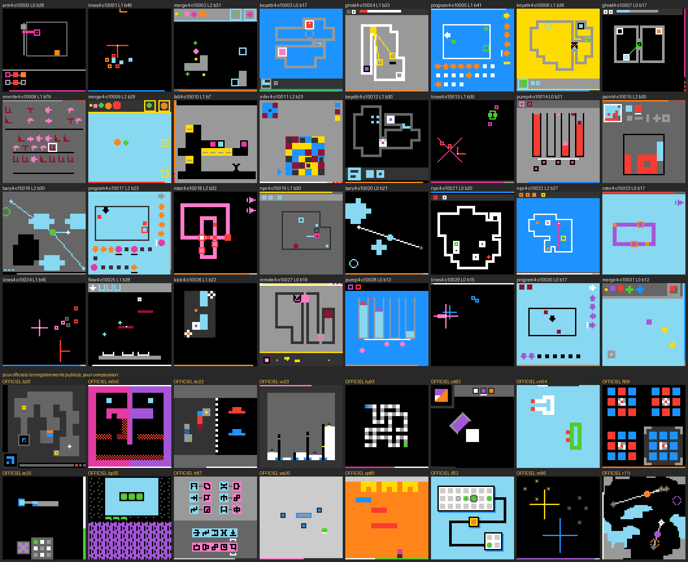

# gen : générateur procédural de jeux « type ARC-AGI-3 »

L'objectif est d'entraîner un world model JEPA sur des centaines de jeux variés, pour qu'il généralise ensuite aux jeux cachés d'ARC-AGI-3.
Ce ne sont **pas** des clones des 25 jeux publics : on reprend les mêmes *principes* (grille, objets, couleurs, actions dont le sens est à découvrir, HUD d'énergie).


`contact_sheet.png` montre la 1re image de 32 jeux générés (2 graines × 16 familles), avec leurs `available_actions`.
Pour régénérer la planche : `python -m gen.sheet [--n 32] [--level 4]`.

## Jeux v4 : MÉCANIQUES et comportement officiels, jugés par un détecteur de faux (`gen/v4/`, `data_v4`)



`contact_sheet_v4.png` : 32 jeux v4 (graines 10000+, niveau 0-2, un tiers de la solution joué) au-dessus de 16 images officielles (`python -m gen.sheet_v4`).
Pourquoi v4 : v3 collait aux statistiques choisies à la main mais restait une « famille » reconnaissable (labyrinthes, grilles de tuiles, plateaux de pions) ; le modèle vidéo transférait mal (F1 0,30 sur v3 inédit, 0,13 sur officiels inédits).

**Étude des mécaniques** : `analysis/MECHANICS.md` (fiche par jeu officiel, 21 PRINCIPES, schémas d'escalade, couverture par v4). Les fichiers de jeu n'ont servi qu'à comprendre : aucun code, niveau ni sprite officiel n'est repris.

**Détecteur de faux** (`gen/discriminator.py`) : petit CNN (patchify 2×2 + 3 convolutions, ~0,1 M paramètres, CPU), officiel vs généré, sur une image (16 canaux one-hot) ou une transition (image, suivante, différence : 33 canaux) ; classes équilibrées ; validation croisée en 5 plis PAR JEU (jeux de test jamais vus, officiels et générés) ; permutation aléatoire des 16 couleurs par exemple ; pas de RESET ni de lignes recopiées côté généré ; 12 000 exemples par classe, 3 époques (~20 min par jeu de données et par entrée sur 2 fils).
`python -m gen.discriminator --gen v4=gen/data_v4 --modes frames,trans --perm 1 --out gen/disc/final_v4.json` (résultats et journaux : `gen/disc/final_v*.json|log`).

| données | entrée | exactitude au seuil 0,5 | exactitude au meilleur seuil | AUC |
|---|---|---|---|---|
| v2 (`data_v2`) | images | 77,2 ± 6,8 % | 85,8 % | 0,910 |
| v2 | transitions | 74,3 ± 8,5 % | 84,1 % | 0,902 |
| v3 (`data_v3`) | images | 77,6 ± 7,3 % | 87,8 % | 0,911 |
| v3 | transitions | 76,0 ± 8,1 % | 87,7 % | 0,912 |
| **v4** (`data_v4`) | images | **52,7 ± 3,4 %** | **73,0 %** | **0,794** |
| **v4** | transitions | **56,7 ± 6,8 %** | **72,3 %** | **0,779** |
| v3, couleurs brutes (`--perm 0`) | images / transitions | 56,6 / 56,9 % | 75,8 / 76,4 % | 0,746 / 0,771 |
| v4, couleurs brutes | images / transitions | 49,7 / 49,6 % | 66,7 / 68,0 % | 0,610 / 0,581 |

Sans permutation, le détecteur apprend les palettes des 20 jeux officiels d'entraînement et généralise MOINS bien aux jeux tenus à l'écart (AUC plus basse pour v3 comme pour v4) : la permutation est la mesure de référence.

⚠ Au seuil 0,5, le détecteur v4 est mal calibré sur les jeux tenus à l'écart (il dit « généré » à presque tout : familles détectées 94-100 %, officiels reconnus ~0-10 %) : l'exactitude à 0,5 sous-estime ce qu'il sait séparer. Les mesures honnêtes sont le meilleur seuil (borne haute) et l'AUC : v4 72-73 % / 0,78-0,79 contre v3 88 % / 0,91.
Familles v4 les plus faciles à repérer (images et transitions) : arm4, infer4, merge4, program4, pump4, rewrite4, twins4, npc4, ghost4, paint4 (100 %) ; les moins : cover4, lines4 (94 %), bary4, remote4, fall4, kick4 (97-98 %). Jeux officiels les plus souvent pris pour des générés : la plupart ; ceux qui passent : tn36, sb26, tr87, m0r0 (transitions).
Ce que l'itération a corrigé (sondes à 190 jeux, `--max_games` pour comparer à v3 à nombre égal) : textures en damier / pointillés (blobs de 1-2 px), panneaux pleins (fond 0,4-0,55 au lieu de 0,74), trop de blobs ; puis la BARRE DE PAS (ablation `--mask_border 3` : 72 -> 63 %) : barre officielle pleine sur toute la largeur au début du niveau, surtout en bas, vies rares -> v4 : barre proportionnelle, bas 60 %, vies 10 %. Sonde transitions : 78 % (p1) -> 72 % (p2) -> 61 % (p3, après la barre).

**Familles** (`gen/v4/fam_*.py`, découverte automatique par `gen/families_v4.py` ; `make_game("cover4", s)` ; mélange `registry.v4_specs(n, seed0)` ; chacune ≥ 2 variantes, niveau 0 tutoriel, une règle nouvelle par niveau dans un ordre tiré par jeu, `rules_per_level` dans games.json) :

| famille | méca. | principe (jeux officiels qui le partagent) | règles ajoutées | baseline méd. |
|---|---|---|---|---|
| `kick4` | objet | contrôle indirect : lancer des blocs qui glissent vers des cadres (ka59, wa30) | zone, plaque d'arrêt, 2e pilote, portail, cibles colorées, case collante | 25 |
| `pump4` | clic | quantités conservées : pompes / vannes, flotteurs sur encoches (vc33) | pompe double, couvercle, flotteur, tuyau, scène tournée, pompes réversibles | 18 |
| `fall4` | avatar | gravité : casser / poser des blocs pour que la chute mène au but (bp35) | gravité inversée, piques, caisses, blocs posés, clics limités, clé | 10 |
| `twins4` | objet | corps couplés (miroir, inverse, rotation) que les murs désynchronisent (m0r0) | danger (retour au départ), bloc, porte à plaque, corps lent, gel, glace, 3e corps | 31 |
| `npc4` | avatar | PNJ au tour par tour ; aides et voleurs à la même routine (tu93, wa30) | patrouilleur, tourelle, double retardé, chien sur rail ; aide, voleur, clôture | 32 |
| `ghost4` | avatar | enregistrer puis rejouer : fantômes qui tiennent des plaques (g50t) | 2 grilles, grille minutée, 2 plaques à la fois, fantômes solides | 36 |
| `remote4` | avatar | groupes de passerelles basculés par un panneau de boutons (dc22) | 2e / 3e groupe, clé, navette, plaque qui allume un bouton | 34 |
| `keyattr4` | avatar | serrures à attributs : stations forme / couleur / rotation (ls20) | couleur, forme, 2-3 portes, recharges, station mobile | 30 |
| `program4` | clic | éditer puis exécuter ; exécution ratée annulée (sb26, tn36) | murs, saut, sous-programme, virages relatifs, cases verrouillées, leurres | 32 |
| `rotor4` | clic | pistes cycliques qui partagent des cases (lp85) | 2e / 3e piste, sens inverse, 2e sorte de tuile, piste à clé, pistes couplées | 24 |
| `rewrite4` | clic | traduire par un tableau de règles affiché (tr87) | chaînes, 2->1, 1->2, runes tournées, leurres, inversion (éditer les règles) | 35 |
| `infer4` | clic | contrainte cachée à inférer d'exemples résolus (ft09) | négation, 3-4 couleurs, diagonales, tuiles verrouillées, contraintes de rangée | 32 |
| `paint4` | objet | couches qui se recouvrent : l'ordre compte (cd82) | couleurs, formes, sous-couche, vignette tournée, miroir | 30 |
| `flow4` | objet | éditer puis lancer un flot ; lancer raté annulé (sp80) | coin, source mobile, 2e source, godets colorés, essais limités, pièges, rotation | 42 |
| `cover4` | objet | pièces + reflets (axes-miroirs) couvrent une silhouette (ar25) | axe mobile, 2e axe, rotation, cases interdites, miroir à un côté, pièce en plus | 58 |
| `lines4` | objet | dessins au trait superposés : chaque point traversé par sa couleur (re86) | bacs de peinture, plots, 3e pièce, points à éviter, point bicolore | 50 |
| `merge4` | clic | impulsion qui attire ; égaux fusionnent vers une recette (su15) | murs, rôdeur, 2 recettes, pierres qui fuient, grande impulsion | 37 |
| `arm4` | objet | bras télescopique qui accroche des blocs dans l'ordre de référence (sk48) | blocs fixes, séquence longue, leurres, dépose, paire collée | 38 |
| `bary4` | clic | corps au barycentre de poignées (r11l) | lacs (coup annulé), 3e poignée, absorbeurs de couleur, poignée clouée, 2e corps | 34 |

- Socle `gen/v4/base.py` (`V4Game`) : rendu NATIF plein écran (×1, 20 % ×2), palette par rôles (`v4/draw.py` : fond noir ~46 %, sinon gris, bleus, blanc, orange), sprites procéduraux dessinés (cadres, plus, L, T, blobs symétriques, runes), pièces bicolores ; sens canonique des actions dans 80 % des jeux ; barre de pas d'1 px proportionnelle (pleine au début du niveau, en bas 60 %), budget 1,6-4× la solution (≥ 24) et dans 40 % des jeux > longueur de la barre (des pas sans aucun pixel changé) ; clics ratés gratuits (`free_miss`) dans les familles à clic ; vies rares (10 %) ; 2e passe de génération relâchée pour les niveaux 0-3 (`self.relax`) ; chaque solution rejouée par `apply()` jusqu'à la victoire, sans mort.
- Solvabilité / oracle : BFS exact (table de distance exacte -> oracle depuis tout état) pour la plupart ; construction à rebours + planificateur (flow4, cover4, lines4), A* / glouton (bary4, merge4 : solutions pas forcément optimales), plan stocké (ghost4).
- Les 23 événements (toucher, corps -> son spatial, son, progrès) sont émis comme partout (`fam_events`, `body`).

**Ressemblance REPORT** (`python -m gen.measure_v3 --data v2=gen/data_v2 --data v3=gen/data_v3 --data v4=gen/data_v4 --data v4val=gen/data_v4_val --out gen/measure_v4.json`) :

| métrique | officiel méd. [IQR] | v3 méd. / dans l'IQR / méd/off | **v4 méd. / dans l'IQR / méd/off** |
|---|---|---|---|
| taille de cellule | 1 [1, 2] | 1 / 81 % / 100 % | **1 / 100 % / 100 %** |
| taille d'objet médiane | 9 [4, 16] | 4 / 64 % / 44 % | **12 / 70 % / 133 %** |
| part du fond | 0,74 [0,57 ; 0,85] | 0,73 / 61 % / 99 % | **0,79 / 72 % / 107 %** |
| jeux à fond noir | 52 % | 55 % / 94 % / 106 % | **46 % / 88 % / 88 %** |
| actions par niveau | 56 [40, 99] | 56 / 94 % / 100 % | **34 / 30 % / 61 %** |
| objets ≤ 4 px | 0,36 | 0,49 / 65 % / 138 % | 0,25 / 60 % / 70 % |
| couleurs par blob | 2,1 | 1,44 / 32 % / 70 % | 1,84 / 58 % / 89 % |
| px changés par action (méd.) | 18 | 26 / 89 % / 144 % | 36 / 68 % / 200 % |
| actions changeant > 4 px | 0,67 | 0,94 / 16 % / 141 % | 0,89 / 30 % / 133 % |

**Jeux de données** (`--behav demo_play` : démonstration de l'oracle puis l'Explorer, AUCUN pas aléatoire ; `--p_full 0.25` : un quart de démonstrations complètes ; même format que `data_v3`, champs `mechanic` / `rules_per_level` / `variant` dans games.json) :
- `gen/data_v4/` (fichiers `v4tr_*`) : **315 381 transitions**, 1 000 jeux (graines 10000-10999, 0 échec de construction), 16 shards, 39 Mo, **1 046 s sur 4 processus**.
  `bash gen/dump_par.sh 1000 4 gen/data_v4 --behav demo_play --v4 --seed0 10000 --steps 330 --p_full 0.25 --prefix v4tr`
- `gen/data_v4_val/` (fichiers `v4val_*`, `basename[:4] == "v4va"`) : **32 185 transitions**, 100 jeux (graines 11000-11099), 4 Mo, 206 s.
  `bash gen/dump_par.sh 100 4 gen/data_v4_val --behav demo_play --v4 --seed0 11000 --steps 330 --p_full 0.25 --prefix v4val`
- Mécaniques : objet 40 %, clic 38 %, avatar 22 % ; 6,7 niveaux par jeu ; baseline médiane 34.
- Mix : oracle 59 %, Explorer 41 % ; épisodes 3 065, longueur moyenne 103 ; doublons 5,7 %.
- Pas avec un événement de contact ou de son 51 % ; `progress` ≠ 0 80 % ; `level_complete` 1,5 % ; corps présent (son spatial) 69 %. Détail : `stats.txt`.
- Tests : `python -m gen.test_v4 [--n 3] [--families …]` (rejeu par `step()`, oracle, règle nouvelle par niveau, demo_play sans aléatoire, part d'actions sans effet par politique, statistiques d'aspect).
- `dump_par.sh` place maintenant chaque jeu de games.json à son index (un jeu raté décalait les suivants ; sans effet sur v1-v3, qui n'avaient aucun échec).

**Écarts restants** : actions par niveau 34 vs 56 (solutions optimales de l'oracle, l'officiel compte des humains) ; trop d'actions à grand effet (px changés ×2) ; pas d'animation multi-images (principe 21) ni de caméra / brouillard ; détecteur encore à 72 % au meilleur seuil (AUC 0,78) — toutes les familles restent repérables individuellement ; données officielles lf52 / bp35 corrompues (image non copiée dans `wm/dump_public.py`, cf. MECHANICS.md).

## Jeux « v3 officiels » : niveaux longs, une règle nouvelle par niveau (`families_v3.py`, `data_v3`)


`contact_sheet_v3.png` : 32 jeux v3 (graines 8000+, niveau 0-2, un tiers de la solution joué) au-dessus d'images officielles (`python -m gen.sheet_v3`).
But : fermer l'écart de `analysis/REPORT.md` (niveaux 3× trop courts, aplats trop gros, fond trop chargé) sans copier aucun jeu officiel.

**Familles** (toujours en look officiel ; `make_game("tiles3", s)` ; mélange `registry.v3_specs(n, seed0)`) :

| famille | mécanique | part | règles ajoutées niveau après niveau | solvabilité / oracle |
|---|---|---|---|---|
| `world3` | avatar | 26 % | monde à modules v2 agrandi (base tirée : maze, keys_doors, switches, color_pads, teleport, hazards, ice, collect, quest) | BFS exact |
| `glyph3` | avatar | 10 % | glyph_key v2 agrandi (couleur → rotation → forme → 2 portes → remise à zéro → lave) | BFS exact |
| `tiles3` | clic | 20 % | NOUVEAU. Tuiles à p états (p = 2, 3, 5), pochoir de base soi / croix puis : croix, diagonales, verrous, miroir (la case symétrique bascule), cases inversées, trous ; cible en haut à gauche, icône du pochoir | solveur exact mod p (élimination de Gauss) : distance optimale et oracle depuis TOUT état ; niveau rejeté si rang < plein |
| `jump3` | clic | 12 % | solitaire long (18-40 sauts) : case-cible, sauts en diagonale, 2 couleurs (on ne capture que l'autre), trous | généré à rebours (soluble par construction) |
| `fleet3` | objets | 20 % | NOUVEAU. Clic (ou ACTION5) = sélection, flèches = déplacer ; 3-4 pièces sur leurs cibles ; barrières de couleur, poussée, paire liée, plaques de glace, lave, portails | cibles construites par une suite légale ; planificateur (BFS par pièce, ordres permutés) = baseline et oracle depuis tout état |
| `coupled3` | objets | 12 % | un contrôle, 2-3 corps : miroir, inverse, rotation, flip, retard | BFS exhaustif de l'état joint |

- Vue v3 (mixin `V3`) : ×1 dans 75 % des jeux (85-100 % pour les labyrinthes), tuiles 3-5 px, murs fins dans 55 %, pourtour = fond dans 75 %, fond noir ≈ 52 %, barre de pas d'1 px partout, vies en option, 6-9 niveaux (tronqué à ≥ 4 si un niveau tardif est introuvable).
- Chaque solution est **rejouée par `apply()` jusqu'à la victoire** à la construction ; `test_v3` la rejoue aussi par `step()`.
- Les 23 événements sont remplis comme ailleurs (toucher, corps = avatar / pièce sélectionnée, son, progrès exact ou heuristique).
- `core.Game.__init__` accepte maintenant qu'un `_make_level` renvoie `None` (jeu tronqué) ; les autres familles ne le font jamais.

**Ressemblance** (`python -m gen.measure_v3 --data v2=gen/data_v2 --data v3=gen/data_v3 --data v3val=gen/data_v3_val`, 30 images par jeu, `measure_v3.json`) — « dans l'IQR » = part des jeux dans l'IQR des 25 officiels :

| métrique | officiel méd. [IQR] | v2 dans l'IQR | **v3 dans l'IQR** | v3 méd. / off. |
|---|---|---|---|---|
| taille de cellule | 1 [1, 2] | 62 % | **81 %** | 100 % |
| taille d'objet médiane | 9 [4, 16] | 63 % | **64 %** | 44 % (méd. 4 px) |
| part du fond | 0,74 [0,57 ; 0,85] | 50 % | **61 %** | 99 % |
| jeux à fond noir | 52 % | 52 % | **55 %** (rapport 94 %) | 106 % |
| **actions par niveau** | 56 [40, 99] | 25 % (méd. 19) | **94 %** (méd. 56) | 100 % |
| objets ≤ 4 px | 0,36 | 57 % | 65 % | 138 % |
| couleurs par blob | 2,1 | 51 % | 32 % | 70 % |
| actions changeant > 4 px | 0,67 | 69 % | 16 % | 141 % |

Restent loin : sprites multicolores (couleurs par blob) et part d'actions sans grand effet (les officiels en ont ~1/3 ; l'oracle et l'Explorer en gaspillent peu).

**Jeux de données** (`--behav demo_play`, aucun pas aléatoire, même format que `data_demo`, champ `mechanic` / `rules_per_level` / `base` en plus dans `games.json`) :
- `gen/data_v3/` (fichiers `v3tr_*`) : **296 836 transitions**, 1 000 jeux (graines 8000-8999), 16 shards, 42 Mo, **847 s sur 4 processus**.
  `bash gen/dump_par.sh 1000 4 gen/data_v3 --behav demo_play --v3 --seed0 8000 --steps 285 --prefix v3tr`
- `gen/data_v3_val/` (fichiers `v3val_*`, `basename[:4] == "v3va"`) : **29 868 transitions**, 100 jeux (graines 9000-9099), 4,3 Mo, 114 s.
  `bash gen/dump_par.sh 100 4 gen/data_v3_val --behav demo_play --v3 --seed0 9000 --steps 285 --prefix v3val`
- Mécaniques : avatar 35 %, clic 33 %, objets 32 % ; 7,5 niveaux par jeu ; baseline médiane 52.
- Mix : oracle 72 %, Explorer 28 % (les solutions longues allongent les segments de l'oracle) ; épisodes 2 388, longueur moyenne 124 ; doublons 4,7 %.
- Pas avec un événement de contact ou de son 50 % ; `progress` ≠ 0 88 % ; `level_complete` 1,2 %. Détail : `stats.txt` dans chaque dossier.
- Tests : `python -m gen.test_v3 [n_seeds] [seed0]` (rejeu, oracle, curriculum, niveaux longs, demo_play sans aléatoire, mélange).

## v3 : jeux à RÈGLES tirées par une grammaire (`grammar.py`, `families_rules.py`)

Idée (façon XLand / ProcGen) : au lieu de 23 familles écrites à la main, **chaque jeu tire ses propres règles**.
Un world model entraîné sur des milliers de jeux aux règles différentes ne peut pas les mémoriser : il doit apprendre à les **découvrir** en jouant.
Les apparences sont aussi tirées (couleur, sprite), donc un même aspect peut avoir des sens différents d'un jeu à l'autre.


`contact_sheet_rules.png` montre la 1re image de 40 jeux à règles, avec leur contrôle, leur but et leurs modules (`python -m gen.sheet_rules`).

**API.**

```python
from gen.registry import make_game, sample_game, rules_specs
from gen.grammar import sample_rules, describe, signature, diversity
g = make_game("rules", 12, look="official")   # id "rules-o0012" ; même API que les autres familles
describe(g.spec)                              # "avatar a5=None | push win=all_on | mods[gate@1,ice@3] | enter(box,pad)->A_to; ..."
sample_game(17, rules_share=0.25)             # mélange : 25 % de jeux à règles ; rules_share=0 redonne EXACTEMENT le mélange v2
sample_rules(5)                               # la spec seule (dict JSON), sans construire les niveaux
```

### La grammaire (`grammar.sample_rules(seed, attempt)`)

Une spec est un dict JSON. Elle combine les composantes suivantes.

- **Types d'objets** (2 à 9 par jeu). Pour chacun :
  - un rôle (simple étiquette : player, box, item, hazard, exit, pad, tele, switch, gate, npc, tile, rock, conveyor, grate…) ;
  - une solidité : `pass`, `block` ou `push` ;
  - contrôlé ou non (1, ou 2 pour un jumeau couplé) ;
  - un mouvement propre : `patrol`, `chase`, `gravity` ou `conveyor` ;
  - des propriétés : porte (`gated`, ouverte selon une variable globale), grille (`grate`, ne bloque que l'avatar « grand »), glissant (`slip`) ;
  - un sprite : style détaillé du noyau, ou motif aléatoire symétrique de 1 à 5 px ;
  - un placement (départ, loin, sur le chemin, intérieur, contre un mur, région…) ;
  - un nombre par niveau (c0 + g·i), et un niveau d'apparition.
- **Contrôle** :
  - `avatar` ;
  - `multi` : tous les avatars bougent ensemble ;
  - `coupled` : un jumeau en `same`, `mirror_h`, `mirror_v`, `invert` ou `rot90` ;
  - `select` : un clic choisit la pièce, les flèches la déplacent ;
  - `cursor` : les flèches déplacent un curseur, ACTION5 active la case ;
  - `click` : clic seul.

  Options : glissade jusqu'au blocage (`slide`), clics « à distance » même en avatar.
  ACTION5 peut être : `wait`, `interact`, `grow`, `gflip` (gravité inversée), `grot` (gravité tournée de 90°), `gate`, `commit` (valider), `activate`, ou rien.
  Le sens des ids d'action est permuté par le noyau, comme pour les autres familles.
- **Interactions**, de la forme « quand A *déclencheur* B → effets ».
  - Déclencheurs : `enter`, `bump`, `push`, `adjacent`, `step`, `click`, `interact`.
  - Effets :
    - sur B : `remove_B`, `B_to C` (changer de couleur ou de type, donc devenir poussable ou statique), `B_step`, `B_slide` ;
    - sur A : `remove_A`, `A_to C`, `teleport_A` ;
    - compteur et portes : `counter_inc`, `spend` (une clé contre une porte), `gate` ;
    - globaux : `gflip`, `grot`, `toggle_all C D`, `grow`, `spawn C` (traînée), `lose` ;
    - voisinage : `flip_nbrs C D` (façon lights-out), `flip_mirror C D` (symétrie).
- **Dynamique globale** : gravité (direction tirée, inversable ou tournable), tapis roulants, PNJ patrouilleurs, PNJ poursuivants (1 tour sur 1 ou sur 2).
- **Victoire** :
  - `reach` : un X sur un Y ;
  - `all_on` : tous les X sur des Y ;
  - `none_left` : plus aucun X ;
  - `counter >= k` ;
  - `pattern` : reproduire le panneau-cible affiché ;
  - `same` : toutes les tuiles de la même couleur.

  Options : « et rejoindre la sortie », et `commit` (valider avec ACTION5 ; une validation fausse donne GAME_OVER).
- **Défaite** : règles `lose` (danger, PNJ), barre d'énergie et vies (noyau), validation ratée.
- **Légende** : un panneau sous séparateur, affiché dans environ 50 % des jeux (toujours pour `pattern`).
  - Il montre la cible du motif, 1 ou 2 règles en icônes (A → B, X ⇒ mort…) et un compteur.
  - Il ne révèle donc qu'**une partie** des règles.
- **Archétypes de départ**, puis règles aléatoires : `reach`, `push`, `collect`, `paint`, `destroy` (contrôle avatar) ; `toggle`, `lights`, `gravity` (clic ou curseur).
  - Le déclencheur, les effets et le but de chaque archétype sont eux-mêmes tirés. Par exemple, `collect` peut se faire par `enter`, `bump`, `adjacent` ou `interact`, et l'objet peut disparaître, compter ou se transformer.
- **Modules** (18 pour l'avatar, 3 pour `toggle`, 4 pour `gravity`) : 0 ou 1 au niveau 0, puis 1 à 3 qui **arrivent aux niveaux 1 à 4**.
  - Exemples : danger (et caisse qui comble le trou), téléporteurs, interrupteur et porte, clé et porte, patrouilleur, poursuivant, tapis, grille et champignon, peinture de caisse, traînée, blocs rouges / bleus, rochers à gravité, dormeur qui s'ouvre à l'approche, coffre (ACTION5), mur fissuré en 2 coups, glace, pont à distance (clic), palet qui glisse.
  - Côté clic : couleur en plus, passage au voisinage, symétrie miroir.
  - Côté gravité : danger, téléporteur, 2e bille, tapis.

**Diversité** (`python -m gen.grammar 10000`) : signature = (contrôle, ensemble d'interactions, victoire).
- Sur **2 000 specs** tirées, il y a **1 459 signatures distinctes** : 284 contrôles et 1 071 ensembles d'interactions.
- Sur **10 000 specs**, il y en a **6 157** : 553 contrôles et 3 925 ensembles d'interactions.

### Le moteur (`families_rules.RuleGame`)

- **État** hashable : `(objets dynamiques triés (r, c, type, aux), V = (compteur, gate, gravité, grand, sélection/curseur, phase, validé))`.
  - Les types qu'aucune règle ne peut modifier sont **statiques** : sorties, plaques, dangers, portes, tapis… Ils sont rangés dans le niveau, hors de l'état, ce qui allège le BFS.
- **Un tour** se déroule ainsi :
  1. action (déplacement des types contrôlés de l'avant vers l'arrière, poussée en chaîne jusqu'à 3, clic, ou ACTION5) ;
  2. règles déclenchées au fil de l'eau (une fois par (règle, A, B) et par tour) ;
  3. dynamique : tapis, PNJ, gravité jusqu'au repos ;
  4. règles `adjacent`.
- Un chemin rapide traite les pas d'avatar dans une case vide.
- **Rendu** : les deux looks du noyau, `classic` et `official`. Il y a 70 % de look officiel dans `rules_specs` et dans le mélange.
  - Murs fins ou pleins, tuiles séparées d'1 px.
  - Porte ouverte dessinée en coins, avatar « grand » plein.
  - Sélection blanche ou pointée, curseur en cadre.
  - Panneau de légende en haut.
  - Barre de pas et vies comme les autres familles.
- **Les 23 événements** sont remplis :
  - `touch` : règle déclenchée par contact, ou blocage contre un objet ;
  - `push`, `collect`, `open`, `color`, `toggle`, `teleport` ;
  - `danger` : un type « mortel » à distance ≤ 1, ou la mort ;
  - corps : avatar, pièce sélectionnée ou curseur.
- **`progress`** est exact quand la table de distance tient sous 5 000 états. Sinon on utilise une heuristique tirée de la condition de victoire :
  - distance au but ;
  - somme des distances X → Y ;
  - objets restants + distance au plus proche ;
  - k − compteur ;
  - cases fausses du motif ;
  - tuiles hors de la couleur majoritaire.

### Niveaux, solvabilité, rejets

- **Niveaux** : 4 à 8 par jeu. La taille du plateau, le nombre d'objets et la profondeur de brouillage croissent avec le niveau, et les modules **ajoutent** types et règles.
  - Les niveaux à clic qui visent `same` ou `none_left` sont générés **à rebours** : on part d'un état but, puis on applique k clics au hasard (k ≤ 4).
  - Le motif `pattern` est l'image d'un état de départ par quelques actions.
- **Vérification de chaque niveau** :
  - BFS exact sur l'état complet, plafonné à **30 000 états** ; `baseline_actions` = longueur **optimale** ;
  - rejet d'un niveau insoluble, gagné au départ, résolu en ≤ 2 actions, trop court pour son rang, ou dégénéré (aucune action n'a d'effet) ;
  - la solution doit **déclencher une règle du module nouveau** (les règles `lose` ne comptent pas, puisqu'elles ne servent jamais à gagner).
- **Rejet d'une spec** : un des 4 premiers niveaux est introuvable en 12 essais, ou le jeu dépasse 5 s de construction.
  - `make_game("rules", seed)` retire alors une autre spec pour la même graine (`attempt` + 1).
  - Les niveaux 5 et suivants peuvent manquer : le jeu est alors tronqué, avec au moins 4 niveaux.

### Mesures (`python -m gen.test_grammar --n 300`, 119 s sur 6 processus)

`test_grammar` vérifie les points suivants :
- chaque niveau est gagné en rejouant la solution BFS **par `step()`** ;
- l'oracle finit le jeu ;
- RESET après WIN ;
- énergie → GAME_OVER, RESET qui garde la progression, GAME_OVER figé.

Résultats :
- **Specs** : 300 tirées, **265 acceptées (88 %)**, toutes rejouées sans erreur.
- **Construction** : 1,4 s CPU par jeu accepté.
- **Niveaux** : 1 468, soit 5,5 par jeu ; 34 % des essais de niveau sont acceptés.
  - Rejets de niveau : insoluble 1 062, trop court 691, mise en place 385, trivial 368, module non utilisé 335, plafond BFS 98, trop lent 40.
- **Acceptation par archétype** :

  | archétype | acceptés / tirés |
  |---|---|
  | reach | 67/74 |
  | collect | 46/52 |
  | toggle | 42/46 |
  | push | 30/36 |
  | gravity | 22/30 |
  | paint | 21/25 |
  | destroy | 19/19 |
  | lights | 18/18 |

- **Baseline moyenne par niveau** (actions optimales) : 5,9 → 6,4 → 8,1 → 9,3 → 10,6 → 11,2 → 12,5 → 12,2 ; médiane 8, max 48.
- **Victoires** : `all_on` 93, `none_left` 89, `pattern` 31, `reach` 26, `counter` 19, `same` 7 ; avec sortie 35 ; `commit` 27.
- **Déclencheurs** : `enter` 383, `click` 334, `bump` 184, `interact` 40, `adjacent` 36, `step` 9.
- **Signatures** : 241 distinctes sur 265 jeux.

### Jeu de données à règles (`gen/data_rules/`)

- **Volume** : **200 000 transitions** de **2 000 jeux à règles distincts** (graines 0 à 1999), 100 pas par jeu.
  - 12 shards (environ 20 k et 13 k transitions par processus), **18,9 Mo**.
  - Durée : **959 s** sur le portable (6 processus).
- **Commande** : `bash gen/dump_rules.sh 2000 100 6 gen/data_rules`, à lancer depuis `arc3/`.
  - Le script lance `rollouts dump --rules --g0/--g1` en parallèle, puis fusionne `games.json`.
  - Pour plus de jeux ailleurs : `bash gen/dump_rules.sh 20000 100 16 gen/data_rules_big`.
- **Format** : celui des shards v1 / v2, avec `events` (N,23).
  - `games.json` ajoute pour chaque jeu : la règle résumée (`rules`), `scheme`, `win`, `arche`, `modules` et `attempt`.
- **Composition** :
  - 71 % en look officiel ;
  - contrôles : avatar 719, click 387, select 274, cursor 244, coupled 224, multi 152 ;
  - 5,6 niveaux par jeu ;
  - 12 % des graines ont dû retirer leur spec.
- **Politique de comportement** : explorer 47 %, aléatoire 27 %, oracle 26 % (`--p_oracle 0.05`).
- **Événements** : `moved` 46 %, `noop` 30 %, `color` 17 %, `click_obj` 14 %, `touch` 13 %, `energy_low` 10 %, `bump` 10 %, `toggle` 6 %, `danger` 4 %, `level_complete` 3,7 %, `collect` 2 %, `game_over` 1,7 %, `push` 1,2 %.
  - Le détail est dans `data_rules/stats.txt`.
- **`progress`** : 16 % < 0, 45 % = 0, 39 % > 0. Moyenne : oracle +0,84, explorer 0,00, aléatoire +0,01.

### Pas encore couvert

- **Baselines courtes** : 6 à 12 actions optimales par niveau, contre 40 à 99 actions humaines pour les officiels. Nos plateaux restent petits pour que le BFS exact tienne sous 30 k états.
- **Absents de la grammaire** :
  - programmes et séquences (sb26, tn36) ;
  - géométrie de lignes (re86) ;
  - caméra et observabilité partielle ;
  - quantités et vases ;
  - capture / fusion ;
  - objets multi-cases et rotation de pièces ;
  - PNJ imitateurs, aides ou voleurs ;
  - fantôme qui rejoue (g50t) ;
  - apparition au clic sur une case vide.
- **Archétypes difficiles à générer** :
  - `gravity` a le plus fort taux de rejet ;
  - `chain` (retirer un nœud bascule ses voisins) a été retiré : l'espace d'états explose et aucun niveau n'était accepté.
- **Légende partielle** : elle n'affiche que 1 ou 2 règles en icônes ; il n'y a pas encore de panneau d'exemples résolus (façon ft09).
- **Module non vérifié** : au dernier essai, un niveau est accepté même si son module nouveau n'est pas utilisé (compté dans `module_unused`).

## Mode `demo_play` : vidéos « le parent montre, le bébé joue » (`rollouts.py`)

Pour un world model **vidéo** (fenêtres de 16 images consécutives + actions, règle du jeu apprise en contexte), les
fenêtres explorer / aléatoire / oracle tirées au hasard étaient peu informatives. Le mode `--behav demo_play` ne
joue **aucune action purement aléatoire**.

- **Démonstration complète** (40 % des jeux, `--p_full`) : l'oracle résout chaque niveau, l'un après l'autre.
  - Il suit la table exacte, sinon la solution BFS stockée.
  - Ce sont des vidéos qui atteignent le but.
- **Démo puis jeu** (60 %), pour chaque niveau :
  1. l'oracle joue un préfixe de longueur tirée dans 0..len de la solution ;
  2. depuis **ce même point**, 1, 2 ou 3 **variantes** (50 / 30 / 20 %) : l'Explorer joue m ~ U(16, 40) pas ;
  3. l'oracle reprend jusqu'au niveau suivant : plan exact depuis l'état courant, ou retour sur la solution, ou RESET puis démo.
  - **Variantes contrefactuelles** : on prend un instantané de l'état dynamique du jeu (`snapshot` / `restore`) et une copie de l'Explorer.
- **Champs en plus** dans les shards : `ep`, `dup`, `mode`, `behav_names`, `mode_names`.
  - `ep` (int32) : identifiant d'épisode, c'est-à-dire d'une suite d'images **sans coupure**, niveaux suivants compris. Il ne change qu'au retour à un instantané.
  - `dup` (bool) : une variante recopie les ≤ 12 dernières lignes du préfixe, marquées `dup=True`, pour garder le contexte de la démo.
  - `mode` : 0 démo complète, 1 démo puis jeu.
- ⚠ **Ici `behav` vaut 0 pour l'oracle et 1 pour l'Explorer.**
- Les 23 événements, `game` et `game_ids` sont gardés : on peut donc exclure des familles.
- Les shards sont coupés aux frontières de jeu, donc les épisodes restent entiers.

**Jeux de données.**
- `gen/data_demo/` : **370 394 transitions**, 1 999 jeux, 23 shards (coupés vers 20 k), **42,6 Mo**.
  - Jeux : 1 000 jeux à règles (graines 7000 à 7999) + 999 familles v2 (graines 7000 à 7999, 84 % en look officiel).
  - Par transitions : 40 % règles, 60 % v2, car les niveaux v2 sont plus longs.
  - Le jeu `paint_copy-o7751` est ignoré : bogue de rendu v2, image trop large à un état atteint en cours de partie.
  - Mix : oracle 47 %, Explorer 53 % ; 23 % des pas en démonstration complète ; doublons 4,4 %.
  - Épisodes : 5 358, longueur moyenne 69 (médiane 52), 91 % font au moins 16 images.
  - Pas avec un événement de contact ou de son : 42 % ; `progress` ≠ 0 : 72 % ; `level_complete` : 2,8 %.
  - Durée : 1 410 s sur 6 processus, plus 426 s pour relancer un morceau.
- `gen/data_demo_val/` (fichiers `dval_*`) : **35 353 transitions**, 200 jeux à règles inédits (graines 6000 à 6199), **3,5 Mo**, 168 s.
  - Mix : oracle 35 %, Explorer 65 %.
  - Épisodes : 581, longueur moyenne 61.
  - Événements 49 %, `progress` ≠ 0 63 %.
- Ni l'un ni l'autre ne recoupe les graines 5000 à 5099 (rval).
- Statistiques : `python -m gen.stats gen/data_demo` (fichier `stats.txt` dans chaque dossier).

## v2 : jeux « façon officielle » (look officiel, curriculum par modules, 6 familles nouvelles)


`contact_sheet_v2.png` montre la 1re image de 32 jeux du mélange v2 (`python -m gen.sheet --mix`).
Écart mesuré au départ : voir `analysis/REPORT.md`.

**API.** Elle est inchangée, avec un argument `look` en plus.

```python
from gen.registry import make_game, sample_game, mixture_specs, PRINCIPLES, FAMILIES_V2
g = make_game("glyph_key", 3, look="official")   # look = "classic" (v1) ou "official" (v2)
g = sample_game(17)                               # mélange v2 : 70 % look officiel, familles v2 favorisées (+ 25 % de jeux à règles v3 ; rules_share=0 = v2 pur)
mixture_specs(240, exclude=("vessels",))          # mélange SANS une famille (évaluation à principe tenu à l'écart)
PRINCIPLES["vessels"]                             # ('quantités conservées : verser, vannes', ['vc33', 'su15'])
```

Les ids de jeu en look officiel portent un `o` : `glyph_key-o0003`.

### Look officiel (`core.py`)

- **Échelle native** : l'écran est agrandi ×1 dans 65 % des jeux, ×2 dans 15 %, ×3 dans 15 % et ×4 dans 5 %. À ×1, une case fait 3 à 5 px.
- **Petits sprites détaillés** : `box_dot`, `eye`, `ring_dot`, `diamond`, `frame`, `small`… Ils ont une couleur de détail (`DETAIL`).
- **Murs** : fins, tracés d'1 px, dans 45 % des jeux ; pleins sinon.
- **Fond** : vide et uniforme. Le fond est noir dans environ 60 % des jeux. Le pourtour vaut le fond, ou il est noir autour d'une petite aire de jeu.
- **Palette** : elle suit l'usage officiel. Le décor est noir, gris 2-4 ou bleu 9-10 ; les objets sont dans les couleurs rares 8, 11, 12, 14, 15 et 6.
- **Barre de pas d'1 px** sur un bord tiré au hasard, dans **100 %** des jeux. Elle perd 1 px par action.
  - Dans 70 % des jeux, l'épuiser donne GAME_OVER ; sinon c'est un simple compteur.
- **Vies** dans environ 30 % des jeux : 3 ou 5 tirets rouges en bout de barre.
  - Une mort fait perdre une vie et redémarre le niveau. Cela émet l'événement `reset` et non `game_over`.
  - À 0 vie, c'est GAME_OVER ; RESET rend alors les vies.
- **Panneau d'inventaire ou de clé** sous un séparateur, dans 50 % des jeux à avatar : clés ramassées, couleur courante, objets restants, glyphe-clé.
- **Sélection** : l'objet sélectionné devient blanc, ou il reçoit un point central.
- **ACTION5 variée** : attendre (monde, PNJ), tourner (`rotate_fit`), valider (`rule_table`), ou rien.
- **6 à 10 niveaux**.

### Monde à modules (`families_world.py`)

En look officiel, les 8 familles d'avatar v1 deviennent un **monde à modules** : `maze`, `keys_doors`, `switches`, `color_pads`, `teleport`, `hazards`, `ice`, `collect`. La famille `quest` est le même monde sans module de base.

- **Base** : la mécanique de la famille.
- **Catalogue** de modules : clés et portes, boutons et portails, recoloration et barrières, téléporteurs (le chemin est coupé), lave, ennemis qui patrouillent en travers du chemin, glace sur les tronçons droits, caisse à pousser sur une plaque qui ouvre un portail, objets à ramasser avant que la sortie s'ouvre.
- **Curriculum** : **chaque niveau ajoute un module**. On garde au plus 3 modules en plus de la base ; le plus ancien sort.
- **Vérifications** :
  - BFS exact sur (position, clés, portail, couleur, caisses, objets, t). La baseline est la solution optimale.
  - On rejoue la solution pour vérifier que **le module nouveau est réellement utilisé**.
- **Baselines** : environ 20 à 130 actions par niveau.

### Familles v2 (`families_v2.py`)

Elles reprennent des principes absents de v1.

| famille | principe (jeux officiels proches) |
|---|---|
| `glyph_key` | L'avatar porte une clé-glyphe (forme, couleur, rotation) que des cases modifient. Une porte-glyphe ne s'ouvre qu'avec la bonne clé. Curriculum : couleur → rotation → forme → 2 portes → case de remise à zéro → lave. (ls20, sc25, cn04) |
| `rule_table` | Un dictionnaire glyphe → glyphe(s) est affiché. Il faut écrire la traduction de la phrase source : soit par clic sur la case, soit au curseur avec les flèches (haut et bas font cycler). ACTION5 sert parfois à valider ; une mauvaise réponse donne GAME_OVER. Les règles 1→2 arrivent au niveau 4. (tr87, sb26, tn36) |
| `coupled_bodies` | Une commande pilote 2 ou 3 corps couplés : même sens, miroir, inverse, flip, rotation de 90°, ou retard d'un pas. But : tous les corps sur leurs cibles, ou les réunir. Les cibles sont un état atteignable lointain (BFS). (m0r0, ar25, r11l, g50t) |
| `vessels` | Des vases. Un clic sur la source puis un clic sur la destination transfère 1 unité ou verse tout ce qui rentre. Des vannes égalisent deux vases voisins. Il faut atteindre les graduations ; la cible est un état atteignable par BFS. (vc33, su15) |
| `npc_rules` | Des PNJ ont un comportement propre : patrouilleur, imitateur (il copie nos pas), poursuivant (il avance un tour sur deux). Les toucher donne GAME_OVER. Un type nouveau arrive à chaque niveau. BFS sur (avatar, PNJ, t). (tu93, wa30, g50t) |
| `capture_merge` | Solitaire. On clique un pion puis une case à 2 cases : le pion saute et capture celui du milieu. Il doit rester un pion, parfois sur la case marquée. Les niveaux sont générés à rebours. (lf52, su15) |

`PRINCIPLES` associe à chaque famille son principe et les jeux officiels qui le partagent. Cela sert à **entraîner sans une famille, puis tester sur le jeu officiel correspondant** : `mixture_specs(..., exclude=(...))`.
Les 23 slots d'événements sont remplis pour toutes les nouvelles familles :
- toucher : contacts, poussées ;
- corps : avatar, corps meneur, ou curseur de `rule_table` ;
- son : clé, ouverture, couleur, bascule, téléport, danger ;
- progrès : table exacte, ou heuristique (distance à la sortie, cycles restants, pions restants…).

### Ressemblance mesurée (`python -m gen.measure_v2`)

On reprend les métriques de `analysis/compare_stats.py`, importées telles quelles. On les calcule sur 30 images par jeu des 240 jeux de `data_v2` (`--data gen/data_v2`). Pour chaque métrique, on donne la part des jeux générés qui tombent dans l'IQR des 25 jeux officiels. Le détail est dans `measure_v2.json`.

| métrique | IQR officiel | mélange v2 (240 jeux) | look officiel seul (165) | look classique seul (75) |
|---|---|---|---|---|
| taille de cellule | [1, 2] | **62 %** | 78 % | 29 % |
| taille d'objet médiane (px) | [4, 16] | **63 %** | 66 % | 56 % |
| part du fond | [0,57 ; 0,85] | **50 %** | 56 % | 36 % |
| jeux à fond noir | 52 % des officiels | **52 %** | 65 % | 24 % |
| actions par niveau (baseline médiane) | [40, 99] | 25 % | 37 % | 0 % |

**Objectif ≥ 50 % atteint** pour la cellule, la taille d'objet, le fond et la part de fonds noirs. **Il n'est pas atteint pour les actions par niveau.**
- Monde à modules et `glyph_key` : 30 à 130 actions par niveau.
- Familles à clic, `vessels`, `rule_table`, `coupled_bodies` : 5 à 25.
- Nos baselines sont des **optima**, alors que celles des officiels sont des **humains** qui explorent : l'écart est en partie structurel.

### Jeu de données v2 (`gen/data_v2/`)

- **Volume** : **300 000 transitions**, 240 jeux du mélange (`mixture_specs(240)`), 1250 pas par jeu. 15 shards d'environ 20 000 transitions, **36 Mo**, 204 s sur le portable.
- **Commande** : `python -m gen.rollouts dump --mix --rules_share 0 --n 240 --steps 1250 --out gen/data_v2` (`--rules_share 0` : sans les jeux à règles v3, ajoutés depuis au mélange par défaut)
- **Format** : celui des shards v1 (avec `events` (N,23)). `games.json` donne, pour chaque jeu : famille, look, baselines, actions, principe et jeux officiels proches.
- **Composition** : 69 % en look officiel. 23 familles ; 7,1 niveaux par jeu en moyenne.
- **Politique de comportement** : explorer 45 %, aléatoire 28 %, oracle 27 %.
- **Événements** : `moved` 48 %, `noop` 31 %, `click_obj` 14 %, `energy_low` 14 %, `bump` 13 %, `toggle` 11 %, `touch` 8,5 %, `color` 6 %, `push` 3 %, `level_complete` 1,4 %, `collect` 1,3 %, `danger` 1,2 %, `game_over` 1,1 %.
  - Le détail est dans `data_v2/stats.txt`.
- **`progress`** : 17 % < 0, 41 % = 0, 41 % > 0 ; moyenne de l'oracle +0,92.
- **Explorer vs aléatoire** (32 jeux du mélange, 300 actions) :

  | agent | niveaux | score type ARC |
  |---|---|---|
  | Explorer | 20/221 | 0,23 |
  | aléatoire | 11/221 | 0,04 |

  Les niveaux sont plus longs qu'en v1.
- **Tests** : `python -m gen.test_gen 3` couvre les 23 familles × 2 looks. Il rejoue les solutions, vérifie l'oracle et la sémantique RESET / énergie / undo, en environ 50 s.

## Familles v1 (16)

| famille | principe |
|---|---|
| `maze` | L'avatar doit rejoindre la sortie (labyrinthe parfait avec boucles, ou pièce encombrée). |
| `keys_doors` | Une clé d'une couleur ouvre les portes de cette couleur. Les portes coupent le chemin, donc l'ordre des clés compte. |
| `sokoban` | Pousser les caisses sur les cibles. Les niveaux sont construits par tirages inverses, puis la solution est raccourcie par BFS. |
| `collect` | Tout ramasser. Dans une variante, la sortie n'apparaît qu'une fois tout ramassé. |
| `switches` | Marcher sur un bouton bascule les portails de sa couleur. Certains portails sont inversés (ouverts au départ). |
| `color_pads` | Une pastille change la couleur de l'avatar. Les barrières et la sortie ne laissent passer que la bonne couleur. |
| `ice` | L'avatar glisse jusqu'à un obstacle. Variantes : cases rugueuses qui l'arrêtent, sortie qui arrête la glissade ou non. |
| `teleport` | Des zones isolées sont reliées par des paires de téléporteurs de même couleur, plus des leurres. |
| `hazards` | Lave et ennemis qui patrouillent : les toucher donne GAME_OVER. Le temps fait partie de l'état. |
| `tilt` | Inclinaison : tous les blocs glissent ensemble. Le but est d'amener le bloc spécial sur la cible. |
| `toggle_match` | Clic : chaque clic fait tourner la couleur d'une case. But : reproduire le motif de référence. |
| `paint_copy` | Clic : on choisit une couleur dans la palette, puis on peint les cases pour copier la référence (gomme en option). |
| `lights_out` | Clic : chaque clic bascule un motif (+, ×, ligne et colonne). But : tout éteindre, ou reproduire une référence. |
| `flood_it` | Clic sur une pastille, ou sur une case du plateau : la région du coin est remplie de cette couleur. But : un plateau d'une seule couleur. |
| `select_move` | Clic pour sélectionner une pièce, puis flèches pour la déplacer. Chaque pièce doit rejoindre sa cible de même couleur. |
| `rotate_fit` | ACTION5 tourne la pièce, les flèches la déplacent, et un clic sélectionne une pièce s'il y en a plusieurs. But : remplir la silhouette. |

Ce qui est tiré au hasard **pour chaque jeu** :
- la palette (fond et murs plutôt dans les gris) ;
- la taille de tuile (1 à 3 pixels logiques) et le style des sprites ;
- les tailles et densités des niveaux, avec 4 à 7 niveaux de difficulté croissante ;
- le sens des ids d'action (canonique 1 à 4 = haut, bas, gauche, droite dans 1 cas sur 2, permuté sinon) ;
- 0 à 2 actions inutiles déclarées dans `available_actions` ;
- l'undo (ACTION7) dans 30 % des jeux ;
- la barre d'énergie (HUD) dans 70 % des jeux. Son budget vaut baseline × U(2,5 ; 5) + 6, et l'épuiser donne GAME_OVER.

## API

```python
from gen.registry import make_game, FAMILIES, game_specs
g = make_game("sokoban", seed=3)       # id de jeu "sokoban-0003", déterministe
obs = g.reset()                        # {frame (64,64) int8, state, levels_completed, win_levels, available_actions}
obs = g.step(3)                        # action simple
obs = g.step(6, {"x": 20, "y": 31})    # clic, en coordonnées écran 64×64
g.baseline_actions                     # meilleure solution trouvée par niveau (équivalent de la baseline humaine)
g.solution_actions(k)                  # solution du niveau k en (action_id, data) : oracle / tests
g.info()                               # carte des actions, HUD, budgets…
```

- **Rendu** : la grille logique est agrandie d'un facteur entier et placée dans un letterbox. Le HUD occupe 1 ou 2 lignes en haut ou en bas.
- **RESET** : il suit la passerelle Kaggle. Après un GAME_OVER, ou en cours de niveau, il redémarre le niveau courant (la progression est gardée). Sur un niveau sans aucune action, il n'a pas d'effet. Après WIN, il ramène au niveau 1.
- **Après GAME_OVER ou WIN** : les autres actions sont sans effet. L'officiel renvoie alors une **liste d'images vide** ; ici `obs["frame"]` reste la dernière image (figée) avec `state = "GAME_OVER"` et l'événement `noop`. Un agent doit donc se fier à `state`, pas à l'image.
- **`toggle_match` et `lights_out`** : les cases sont toujours séparées d'1 px, sinon les cases voisines de même couleur fusionnaient en un seul objet.
- **Solvabilité** : chaque niveau est vérifié de l'une de deux façons :
  - par un BFS sur l'état (plafond de 20 à 30 k états) ;
  - ou par construction (tirages inverses, presses aléatoires, solution gloutonne, BFS pièce par pièce). La solution est alors une meilleure solution trouvée, pas forcément optimale.

  `test_gen.py` **rejoue chaque solution à travers `step()`** et vérifie que le niveau est gagné.

## Événements privilégiés `obs["events"]` (SON / TOUCHER / CORPS / PROGRÈS)

Ce sont des **cibles auxiliaires d'entraînement seulement** : les vrais jeux n'ont pas ces signaux, et au test le modèle ne voit que les images.
C'est l'idée du bébé multisensoriel : prédire le son et le toucher pousse l'encodeur visuel à apprendre les contacts, l'agentivité et l'avancée vers le but.

Le vecteur est en `float32`, de longueur `N_EVENTS = 23`. Il a **la même disposition pour les 16 familles** (un slot inutilisé vaut 0) ; les noms sont dans `core.EVENT_NAMES`.

| idx | nom | sens |
|---|---|---|
| 0 | `bump` | Déplacement (ou rotation) bloqué : l'objet contrôlé n'a pas pu bouger. |
| 1 | `push` | Un autre objet a été poussé (caisse sokoban, blocs de `tilt`). |
| 2 | `touch` | Contact avec un objet : clé, porte, bouton, pastille, barrière, téléporteur, objet ramassé, pièce voisine, lave ou ennemi. |
| 3 | `click_obj` | Le clic tombe sur un objet (pixel ni fond ni mur). |
| 4 | `click_empty` | Clic dans le vide ou hors de la grille. |
| 5-8 | `pos_r0, pos_c0, pos_r1, pos_c1` | Position de l'objet contrôlé avant et après l'action, en cases logiques normalisées dans [0, 1] ; −1 s'il n'y en a pas (jeux à clic seul, aucune pièce sélectionnée). |
| 9 | `moved` | L'objet contrôlé a bougé. |
| 10 | `collect` | Objet ou clé ramassé. |
| 11 | `open` | Porte ou portail ouvert. |
| 12 | `color` | Changement de couleur : avatar, case basculée, peinture, remplissage. |
| 13 | `toggle` | Bascule : case, lampe, bouton, ou sélection d'une pièce ou d'une couleur. |
| 14 | `teleport` | Téléportation. |
| 15 | `danger` | Lave ou ennemi à distance ≤ 1 après l'action (ou mort). |
| 16 | `energy_low` | Énergie ≤ 25 % du budget. |
| 17 | `level_complete` | Niveau réussi. |
| 18 | `game_over` | GAME_OVER (mort, ou énergie épuisée). |
| 19 | `reset` | L'action était un RESET. |
| 20 | `undo` | L'action était un undo. |
| 21 | `noop` | L'état du jeu n'a pas changé (le HUD a pu bouger). |
| 22 | `progress` | Variation de la distance au but, dans [−1, 1] ; positif = on se rapproche. |

Comment `progress` est calculé :
- **Distance au but exacte** quand c'est possible : exploration complète des états du niveau (≤ 20 k états), puis BFS inverse depuis les états gagnants. Un pas optimal vaut alors +1.
- **Cas exacts** : toutes les familles avatar ; `sokoban` jusqu'à 2 caisses ; `select_move` jusqu'à 2 pièces ; `rotate_fit` avec 1 pièce.
- **Heuristique sinon** :
  - `sokoban` : somme des distances caisse → cible ;
  - `select_move` : somme des distances pièce → cible ;
  - `rotate_fit` : distance des centres + rotation ;
  - `toggle_match` : nombre de clics restants (exact) ;
  - `paint_copy` : formule optimale (exacte) ;
  - `lights_out` : cases fausses / 3 ;
  - `flood_it` : couleurs restantes ou part hors région.
- **Cas particuliers** : mort ou impasse (but devenu inatteignable) = −1.

L'oracle `g.oracle_action()` donne une action optimale depuis l'état courant (table exacte). Sinon il suit la solution stockée, ou fait RESET.

## Commandes

```bash
cd arc3
.venv/bin/python -m gen.test_gen 3 [classic|official]   # solutions rejouées, oracle, RESET/énergie/undo (~50 s)
.venv/bin/python -m gen.rollouts eval [--mix] --n 32 --budget 300               # Explorer vs aléatoire
.venv/bin/python -m gen.measure_v2 [--data gen/data_v2]                        # ressemblance aux officiels
.venv/bin/python -m gen.rollouts dump --n 160 --steps 1500                      # 240 k transitions (~4 min)
.venv/bin/python -m gen.rollouts dump --n 400 --g0 160 --g1 400 --steps 1500   # suite (jeux 160..399), ailleurs
.venv/bin/python -m gen.stats                                                  # fréquences d'événements, progrès
.venv/bin/python -m gen.test_grammar --n 300 --workers 6                       # jeux à règles : rejeu, acceptation, diversité (~2 min)
.venv/bin/python -m gen.grammar 10000                                          # signatures distinctes sur 10 000 specs (sans niveaux)
.venv/bin/python -m gen.sheet_rules --n 40                                     # planche des jeux à règles
bash gen/dump_rules.sh 2000 100 6 gen/data_rules                               # jeu de données à règles (N, pas/jeu, processus)
bash gen/dump_par.sh 2000 6 gen/data_demo --behav demo_play --demo_mix --seed0 7000 --steps 250             # vidéos démo + jeu
bash gen/dump_par.sh 100 4 gen/data_demo_val --behav demo_play --rules --seed0 6000 --steps 400 --prefix dval  # validation
.venv/bin/python -m gen.rollouts dump --mix --rules_share 0.25 --n 240 --steps 1250 --out gen/data_v3   # mélange v2 + règles
```

Format des shards (`gen/data/shard_gGGG_KKK.npz`, compressés, environ 20 k transitions chacun) :

| champ | contenu |
|---|---|
| `obs`, `next_obs` | (N,64,64) int8 |
| `act` | (N,) int8 ; 0 = RESET |
| `click` | (N,2) int8, (x, y) ; -1 s'il n'y a pas de clic |
| `events` | (N,23) float32 ; noms dans `event_names` |
| `game` | (N,) int16 ; index dans `game_ids` |
| `level` | int8 ; niveaux réussis avant l'action |
| `state` | int8, état après l'action : 0 en cours, 1 WIN, 2 GAME_OVER |
| `done` | bool ; niveau gagné ou GAME_OVER |
| `behav` | int8 ; 0 explorer, 1 aléatoire, 2 oracle |

`game_ids` donne la correspondance index → id de jeu.

La politique de comportement est mixte :
- l'Explorer joue, et une part ε ~ U(0,15 ; 0,6) de ses actions est remplacée par une action aléatoire ;
- des segments « oracle » de 8 à 40 pas (environ 21 % des pas) vont vers le but, pour que des transitions qui atteignent le but existent.

Pour aller plus vite, `rollouts.py` remplace la segmentation de l'Explorer par `fastcomp.components` : même sortie, environ 5 fois plus rapide.

## Premiers résultats (32 jeux, 300 actions par jeu)

| agent | niveaux | jeux avec ≥ 1 niveau | score moyen type ARC |
|---|---|---|---|
| Explorer | 34/190 | 19/32 | 0,39 |
| aléatoire | 21/190 | 12/32 | 0,16 |

Ce qui ressort :
- **Les plus faciles** : `tilt`, `ice`, `lights_out`, `teleport`.
- **Restés à 0 pour les deux agents** : `keys_doors`, `color_pads`, `paint_copy`, `flood_it`, `toggle_match`.
- **Toggle_match** : les cases sont maintenant séparées et les clics de l'Explorer basculent bien des cases (67 % de ses clics). Il échoue quand même : le problème est combinatoire.

## Jeu de données actuel (`gen/data/`)

- **Volume** : 160 jeux × 1500 pas = **240 000 transitions**, 12 shards, **27 Mo**, 230 s.
- **Politiques** : explorer 49 %, aléatoire 30 %, oracle 21 %.
- **Fréquence des événements** :

  | événement | % des pas |
  |---|---|
  | `moved` | 48 |
  | `noop` | 38 |
  | `click_obj` | 18 |
  | `bump` | 15 |
  | `energy_low` | 10 |
  | `toggle` | 7,7 |
  | `color` | 7,3 |
  | `touch` | 6,7 |
  | `undo` | 5,7 |
  | `click_empty` | 4,3 |
  | `push` | 3,0 |
  | `level_complete` | 1,9 |
  | `danger` | 1,8 |
  | `reset` | 1,8 |
  | `game_over` | 1,3 |
  | `collect` | 0,44 |
  | `open` | 0,41 |
  | `teleport` | 0,40 |

- **Avatar présent** : 72 % des pas.
- **`progress`** :
  - 17,5 % < 0, 44,8 % = 0, 37,7 % > 0 ;
  - moyenne : oracle +0,92, explorer 0,00, aléatoire +0,02.
- **Niveaux couverts** : niveaux 0 à 6, niveau max moyen par jeu 4,5.
